<h1 align="center">Ja Servus 👋 I'm <strong><a href="https://home.master3307.org/card">MrKoby07</a></strong>! :D</h1>

Welcome to my README! Here's a little about me:

Formerly I was known as Master3307. I had that username for about 3 years. Generally I am a very thoughtful and careful person. I like to try new things a lot and I think ahead but sometimes even too much. I love to hoard Information and I archive a lot of stuff just because I like to keep things and look back :D

> Feel free to look through these Dropdowns for Information :3

<strong>👤 Personal</strong>

- Name: Korbinian
- Birthday: 09.09.
- Location: Germany, Bavaria
- Language: German (native), English (fluent)

<strong>🎮 Interests / Hobbies</strong>

- Gaming
- Modding
- Archiving
- Programming
- Exploring new things
- Psychology

<strong>🧠 Skills</strong>

- Fast learner
- Quickly understands different topics
- Good at problem-solving
- Creative thinker
- Strong attention to detail

<strong>🔗 Links</strong>

- [HomeSite](https://home.master3307.org)
- [Usercard](https://home.master3307.org/card/)
- [YouTube](https://www.youtube.com/@Master3307)

<strong>🖥️ PC Specs</strong>

- CPU: AMD Ryzen 5 5600X
- GPU: NVIDIA GeForce RTX 4060 AERO 8GB
- RAM: Kingston Fury Beast 32GB (2x16GB) DDR4
- Monitor: 1920x1080 60Hz Samsung S22D300

<strong>🌎 Help Translate</strong>

If you want, help translate my Home Site and other Projects to different Languages. Want a Language added? Tell me!

Feel free to explore some of my repositories. :3

<strong>📊 Stats</strong>

  

  
   
  
  
   
  
  

  

  

