  

  <picture>
    
  </picture>

  Formerly, I was known as Master3307. I had that username for about 3 years.
  Generally, I am a very thoughtful and careful person. I like to try new
  things and think ahead—sometimes even a little too much. I love to
  hoard information and archive a lot of stuff simply because I like to
  keep things and look back. :D

  <picture>
    
  </picture>

  

    <picture>
      
    </picture>
  

  

    <picture>
      
    </picture>
  

  

    <picture>
      
    </picture>
  

  

    <picture>
      
    </picture>
  

  

    <picture>
      
    </picture>
  

  

    <picture>
      
    </picture>
  

  

    <picture>
      
    </picture>
  

  

    
     
    
     
    
  

  

    <picture>
      
    </picture>
  

  

    <picture>
      
    </picture>
  

  

    <picture>
      
    </picture>
  

  

    If you want, help translate my HomeSite and other projects into different
    languages. Want a language added? Tell me!
  

  

    
  

  

    <picture>
      
    </picture>
  

  

    
  

  

    <picture>
      
    </picture>
     
    <picture>
      
    </picture>
    <picture>
      
    </picture>
     
    <picture>
      
    </picture>
    <picture>
      
    </picture>
  

  

    <picture>
      
    </picture>
  

  

    <picture>
      
    </picture>
  

  <picture>
    
  </picture>

